# Evidence-Aware Adaptive RAG for Cardiology QA

> **A local, auditable research prototype and evaluation resource** comparing fixed top-k retrieval with evidence-gated retrieval, one bounded retry, and abstention for cardiology educational questions.
>
> **Status:** exploratory research. **Not** a medical device, diagnostic service, or substitute for professional care. Never use outputs for clinical decisions and never enter personal health information.

---

## Table of Contents

1. [TL;DR](#1-tldr)
2. [Headline Results](#2-headline-results)
3. [Research Question, Motivation and Novelty Limits](#3-research-question-motivation-and-novelty-limits)
4. [Relation to Cardiology-Chat](#4-relation-to-cardiology-chat)
5. [Scope and Non-Goals](#5-scope-and-non-goals)
6. [System Architecture](#6-system-architecture)
7. [The EA-RAG Policy](#7-the-ea-rag-policy)
8. [Evaluation Resource (D1–D6)](#8-evaluation-resource-d1d6)
9. [Experimental Design](#9-experimental-design)
10. [Detailed Results](#10-detailed-results)
11. [Discussion](#11-discussion)
12. [Threats to Validity](#12-threats-to-validity)
13. [Current Implementation](#13-current-implementation)
14. [Setup and Usage](#14-setup-and-usage)
15. [Optional Datasets: NHLBI and MedQA-USMLE](#15-optional-datasets-nhlbi-and-medqa-usmle)
16. [Safety, Privacy and Licensing](#16-safety-privacy-and-licensing)
17. [Repository Layout](#17-repository-layout)
18. [Roadmap / Remaining Work](#18-roadmap--remaining-work)
19. [Definition of Done](#19-definition-of-done)
20. [References](#20-references)
21. [Notes on This Document](#21-notes-on-this-document)

---

## 1. TL;DR

Many RAG systems for medicine are motivated by "reducing hallucination," and some add a **retrieval-score gate** so the system can abstain when evidence looks weak. Whether such a gate actually identifies the questions a system would answer wrongly is rarely measured.

This project:

- Builds a **frozen, hash-verified, leakage-audited evaluation resource** from public data (cardiology MCQs, case reports, guideline chunks, perturbation sets).
- Implements **fixed top-k RAG** and **EA-RAG** (intent-aware query expansion → evidence gate → one bounded retry → abstention), plus two ablations.
- Runs a **paired evaluation** on 609 held-out cardiology questions with a 31B generator over a three-guideline corpus.
- Reports an honest **negative result**: a percentile-calibrated lexical gate was **not** a reliable proxy for answer correctness.

We do **not** claim algorithmic novelty. The contribution is the evaluation protocol, the audited resource, and the empirical coverage/robustness findings.

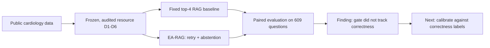

---

## 2. Headline Results

All numbers are from the D2 test set (609 questions), lexical BM25-style retrieval, top-k = 4, and Ollama Cloud `gemma4:31b` at temperature 0.

| Arm | Correct / N | Overall accuracy (abstain = wrong) | Coverage | Selective accuracy | Retry rate |
|---|---|---|---|---|---|
| Fixed top-4 baseline | 555/609 | **91.1%** [88.6, 93.1] | 100% | 91.1% | 0% |
| EA-RAG | 487/609 | 80.0% [76.6, 83.0] | 87.2% (531) | **91.7%** [89.1, 93.8] | 19.4% (118) |
| EA-RAG without abstention | 561/609 | **92.1%** [89.7, 94.0] | 100% | 92.1% | 19.4% |
| EA-RAG without adaptation | 465/609 | 76.4% [72.8, 79.6] | 83.4% (508) | 91.5% | 0% |

Key takeaways:

- On the **531 questions EA-RAG chose to answer**, it scored 91.7% vs. 91.3% for the baseline (exact McNemar p = 0.6875): **no significant selective-accuracy difference**.
- Counting abstentions as errors, EA-RAG is **11.1 points worse** than the baseline.
- Of EA-RAG's **78 abstentions, 74 concerned questions it answered correctly** when abstention was disabled.
- The **retry** recovered coverage (83.4% → 87.2%) without a measurable change in selective accuracy.
- On the **21-item P5 stress test**, both systems scored 19/21 and the gate **never fired**.
- On **D1 stage 1** (retrieval-only audit), 23% of retrievals fell below the retry cutoff and 10% ended in abstention. No diagnostic accuracy is reported.

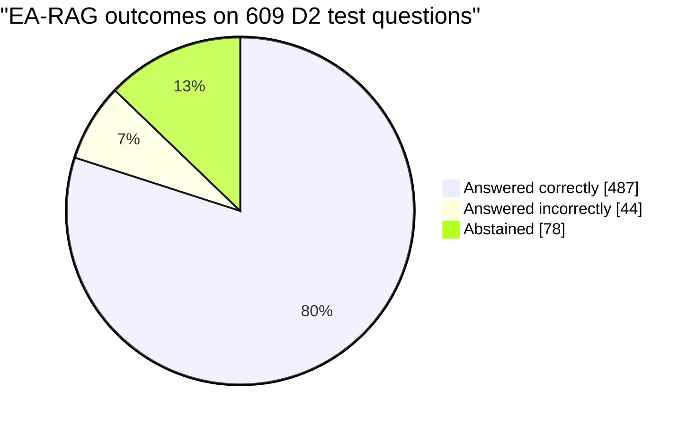

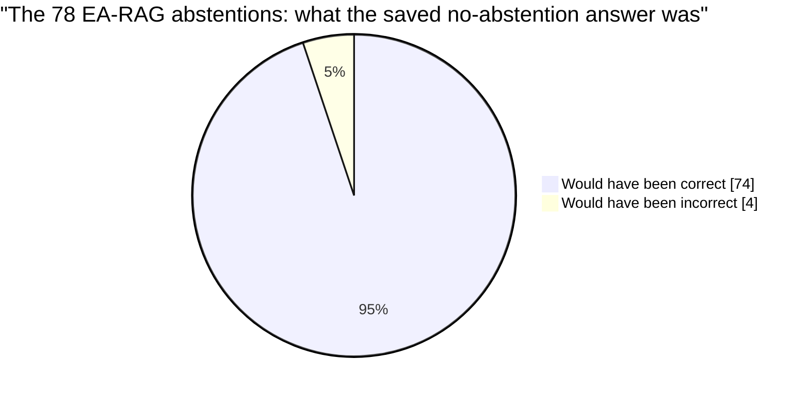

---

## 3. Research Question, Motivation and Novelty Limits

**Primary research question:** On a fixed cardiology-oriented guideline corpus and MCQ set, does a lexical-score evidence gate with one bounded retry and abstention improve selective answer quality over fixed top-k RAG?

**Motivation.** Cardiovascular disease is the leading cause of death worldwide, and LLMs can produce plausible but incorrect medical statements. RAG is a common response. A system that can *abstain* is only safer if its abstention signal tracks correctness. A retrieval score measures query–passage match, not answer correctness, so that assumption needs testing.

**Novelty limits.** Adaptive retrieval, corrective retrieval, and selective prediction are established research areas (Self-RAG, Corrective RAG, Adaptive-RAG, selective classification). This project:

- **does not** claim algorithmic novelty for score gating, retry, or abstention;
- **does** contribute a cardiology-oriented paired evaluation, an audited public-data resource, a two-pass trace-derived ablation design, and a documented negative result.

EA-RAG is a deliberately simple, transparent relative of learned-critic methods, using a lexical score instead.

---

## 4. Relation to Cardiology-Chat

This prototype is *inspired by* — but does not reproduce — **Cardiology-Chat** (Yang et al., *IEEE J. Transl. Eng. Health Med.*, 2026, DOI: [10.1109/JTEHM.2026.3668755](https://doi.org/10.1109/JTEHM.2026.3668755)).

### 4.1 What Cardiology-Chat does

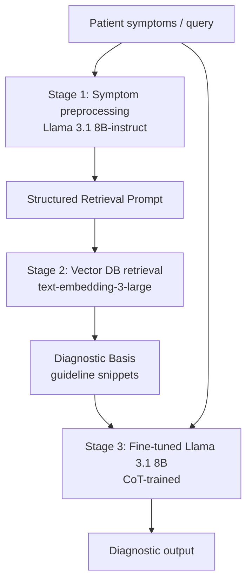

Key elements of the paper:

- **Cardiology-specific knowledge base** built mainly from Chinese national guidelines and expert consensus (mostly 2021–2024), plus medical websites; DeepSeek-V3 converts sources to hierarchical Markdown, chunked by heading structure.
- **27k-example CoT dataset:** ~7k validated CoTs (DeepSeek-V3 generator, DeepSeek-R1 validator, three repair strategies, 76% acceptance of 9.2k candidates) plus 20k public CoTs (HuatuoGPT-o1 data).
- **Full-parameter SFT** of Llama 3.1 8B-instruct (3 epochs, lr 5e-6, 2× A800 GPUs).
- **Evaluation:** 182 cardiology MCQs (from MedQA-test, MedMCQA-val, PubMedQA-test screened via MeSH C14) and 49 anonymized in-house cardiology cases.

### 4.2 Paper-reported results (not targets for this project)

| Metric | Cardiology-Chat 8B | w/o RAG | Llama 3.1 8B-Instruct |
|---|---|---|---|
| QA accuracy (n=182) | **0.796** | 0.703 | 0.612 |
| In-house Precision / Recall / F1 (n=49) | 0.853 / 0.766 / **0.807** | 0.792 / 0.671 / 0.726 | 0.622 / 0.528 / 0.571 |
| Top-1/3/6 accuracy (QA) | 41.8 / 69.8 / 76.9% | 36.4 / 61.2 / 72.5% | – |
| Brier / ECE (QA) | 0.548 / 0.552 | 0.612 / 0.601 | – |

Ablation in the paper: SFT w/ simple CoT 0.637 → SFT w/ reliable CoT 0.703 → +RAG unstructured KB 0.727 → +RAG structured KB 0.796.

### 4.3 How this project differs

| Dimension | Cardiology-Chat | This project |
|---|---|---|
| Goal | Build a fine-tuned diagnostic system | Test whether a retrieval-score gate predicts answer correctness |
| Generator | Fine-tuned Llama 3.1 8B | Off-the-shelf `gemma4:31b` (no cardiology fine-tuning) |
| Retrieval | Dense (text-embedding-3-large) | Lexical BM25-style (dense code present, not used in headline results) |
| Corpus | Chinese guidelines + websites | Three public guidelines (ACC/AHA 2020 VHD, ESC ACS 2023, ESC HF 2026) |
| Abstention | Not evaluated | Core subject of study |
| Clinical data | 49 private in-house cases | Public data only; no patient records |
| Reproducibility | Private clinical set | Hash-verified public-data resource |

> **The numbers are not comparable.** Question sets, generator, corpus, and evaluation protocol all differ. The Cardiology-Chat paper also reports no unsupported-claim rates, abstention behavior, or perturbation experiments, and its clinical cases are not public.

---

## 5. Scope and Non-Goals

### In scope
- Cardiology-focused QA over a small, documented public-source corpus.
- Pre-chunked D4 loading, lexical retrieval, optional dense retrieval code, answer generation, citation checks, evidence gating, retry, and abstention.
- A baseline RAG and an EA-RAG variant evaluated on identical questions.
- Reproducible metrics, error analysis, configuration, logs, and a small demo interface.

### Out of scope
- Clinical diagnosis or treatment recommendations for real patients.
- Fine-tuning an 8B model or reproducing the 27k reasoning dataset.
- Access to private hospital records or protected health information.
- Claims of clinical validation, safety, or clinician equivalence.
- Fabricating results, datasets, citations, or comparisons.

---

## 6. System Architecture

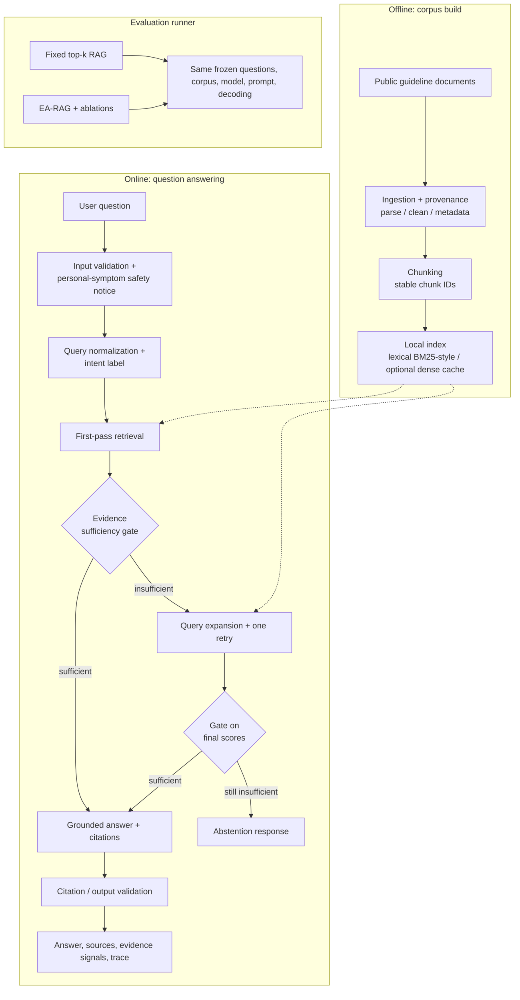

### 6.1 Components and contracts

#### Document ingestion
Each source must be public and permitted for the intended use. Store title, publisher, URL, access date, document date/version, and license notes. Prefer authoritative guideline or public-health sources, and do not silently mix outdated and current guidance. Start small (roughly 10–30 documents) and document inclusion criteria.

```json
{
  "document_id": "stable-source-id",
  "title": "Source title",
  "publisher": "Organization",
  "url": "https://...",
  "published_date": "YYYY-MM-DD or null",
  "accessed_date": "YYYY-MM-DD",
  "license_note": "usage notes",
  "text": "cleaned text"
}
```

#### Chunking and indexing
- Preserve heading hierarchy and source metadata.
- Defaults: 550 whitespace-delimited words with 80 words overlap (tune only on development data).
- Stable IDs of the form `document_id:section:chunk_number`.
- Persist the index **and** the exact corpus manifest; never rebuild an evaluation index from untracked sources.
- Architecture notes contemplate FAISS/Chroma behind a small retrieval interface; the reported experiments use **lexical retrieval only**.

#### Query processing
Returns a normalized query and one intent label using a deterministic keyword/rule baseline (no external model required).

| Intent label | Meaning |
|---|---|
| `definition` | "What is…" style questions |
| `risk_factor` | Risk factors / causes |
| `symptom_condition` | Symptoms / condition presentation |
| `test` | Diagnostic tests |
| `treatment` | Therapy / management |
| `comparison` | Comparing conditions or options |
| `other` | Fallback to the standard retrieval path |

#### Retrieval
- **Baseline:** fixed-k top-k (k = 4 in the reported experiments; 4–5 by default).
- **EA-RAG:** intent-aware normalization/expansion, initial top-k, evidence check, and **at most one** retry with an expanded query. Corpus, generator, prompt, and evaluation set are identical to the baseline.

#### Evidence sufficiency gate
Transparent heuristics, with component signals exposed in logs and the UI:

- Score threshold calibrated on development data only.
- Configurable minimum number of usable passages.
- Optional lexical overlap / key-entity coverage.
- At most one retry (bounds latency).
- Abstain when evidence remains insufficient.

> The architecture design also contemplates an **agreement/contradiction check** across top passages. **The implemented version does not measure passage agreement or direct entailment.** Scores are ranking signals, **not** calibrated clinical confidence.

#### Answer generation
Provider abstraction (API model or local model); no hard-coded secrets. If no LLM is configured, a deterministic extractive fallback is used and labeled as such (it cannot answer MCQs, so the evaluator refuses to report fake accuracy).

Prompt requirements: answer only from supplied context; cite factual statements with stable chunk IDs; say when evidence is insufficient; separate source statements from cautious synthesis; never claim to diagnose or replace a clinician; show a short safety notice for emergencies/personal symptoms rather than attempting triage.

#### Citation validation
Structural check only: every cited chunk ID must exist in the retrieved set (open-ended answers also need at least one citation per paragraph/claim group). For MCQs, citations are optional but any IDs included must match retrieved chunks. **This is not proof of semantic support.**

#### Interface
Minimal Streamlit UI: question input, answer or abstention, retrieved snippets with title/date/URL, evidence signals and retry status, and a "research prototype, not for medical use" notice.

---

## 7. The EA-RAG Policy

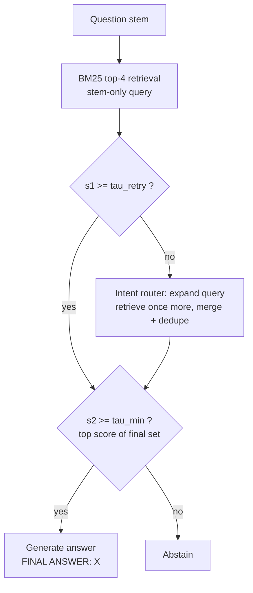

- **Retry cutoff** `τ_retry` and **sufficiency cutoff** `τ_min` apply to the top lexical score (`s1` before retry, `s2` after).
- At most one retry. If `s1 ≥ τ_retry`, no retry and the first-pass result goes straight to the final gate.
- Frozen thresholds in the reported run: **`τ_min = 0.9256`** (10th percentile of validation top-1 scores) and **`τ_retry = 0.9294`** (15th percentile).
- Only the **question stem** is used as the retrieval query in the reported run; answer options appear in the prompt but not in the query.

### Ablations

| Ablation | What changes |
|---|---|
| **EA-RAG without abstention** | Keeps the retry but always returns a candidate answer even when the final gate would abstain |
| **EA-RAG without adaptation** | Keeps first retrieval and the sufficiency gate; skips the retry/expansion |

---

## 8. Evaluation Resource (D1–D6)

A multi-tiered, locally prepared suite for cardiology-oriented QA, perturbations, guideline retrieval, and staged case prompts. **Components have different provenance and validation levels; not every artifact is a gold benchmark or an independent clinical cohort.** All assets are derived from public sources, and no patient records are used.

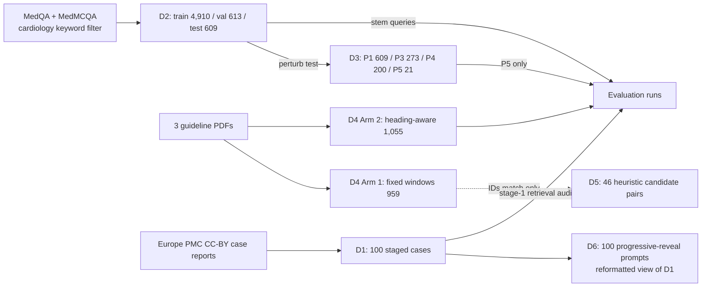

### 8.1 Asset overview

| Asset | Sub-split / arm | Items | Purpose | Used here? |
|---|---|---:|---|---|
| **D1** | Staged real cases | 100 | Longitudinal clinical reasoning (2025–2026, CC-BY) | Retrieval audit only (no accuracy) |
| **D2** | Test | 609 | Primary evaluation MCQ set (273 MedQA + 336 MedMCQA) | **Yes** (evaluation) |
| | Validation | 613 | Threshold calibration, prompt tuning (273 MedQA + 340 MedMCQA) | **Yes** (100-record calibration sample) |
| | Train | 4,910 | Deduplicated exemplar / SFT pool | No |
| **D3** | P1 option permutation | 609 | Position bias / answer-order sensitivity | Built, not evaluated |
| | P3 noise injection | 273 | Resilience to non-contributory history | Built, not evaluated |
| | P4 safe numeric jitter | 200 | Robustness to non-critical vital-sign changes | Built, not evaluated |
| | P5 finding stripping | 21 | Robustness when anchor findings removed | **Yes** |
| **D4** | Arm 1 naive fixed window | 959 | 380 words/chunk, 50-word overlap | Not in headline results |
| | Arm 2 hierarchical | 1,055 | Heading-aware, ≤500 words | **Yes** (retrieval corpus) |
| **D5** | Retrieval candidate pairs | 46 | Heuristic query→chunk candidates; **not** human-judged; IDs match fixed D4 only | No |
| **D6** | Progressive reveal | 100 | Staged prompts linked to D1 (100/100 DOI links); **not independent** | No |

### 8.2 D2: question set

Pooled four-option **MedQA (USMLE-style)** and **MedMCQA** items, filtered with cardiology keyword rules, deduplicated, then re-split 80/10/10. MedMCQA test items are mostly multi-sentence (only 17 of 336 are ≤15 words), so the set is not dominated by single-fact recall.

```json
{
  "id": "medqa_1042",
  "source": "medqa",
  "question": "A 62-year-old man presents with progressive dyspnea...",
  "options": {"A": "Aortic stenosis", "B": "Hypertrophic obstructive cardiomyopathy",
              "C": "Dilated cardiomyopathy", "D": "Constrictive pericarditis"},
  "answer": "A",
  "explanation": "Rationale text (excluded from Knowledge Base to prevent RAG leakage)",
  "category": "Structural Heart Disease"
}
```

Audit status: 0 exact-match and 0 near-duplicate overlaps (word-level Jaccard < 0.80) across splits, and no conflicting answers. Four near-duplicates were removed from an earlier 613-item test set. **OCR cleanup was attempted, but the audit still flags 4 OCR-damage markers in D2 validation and 4 in D2 test (MedMCQA records); review them before calling the split fully clean.**

### 8.3 D3: perturbations

- **P1 (N=609):** options shuffled, key remapped.
- **P3 (N=273):** long MedQA vignettes injected with non-contributory history (e.g., mild managed seasonal allergies).
- **P4 (N=200):** vitals jittered within strict bands without crossing diagnostic cutoffs:
  - Heart rate: bradycardic stays < 60, normal 60–100, tachycardic > 100 bpm.
  - Blood pressure: normal 90–139 / 60–89 mmHg; hypertensive crisis stays ≥ 180 / 120 mmHg.
- **P5 (N=21):** high-yield anchors (e.g., *holosystolic murmur*, *thrill*, *Aschoff bodies*, *apical ballooning*) replaced with neutral text. In practice it affected 21 questions, almost all by removing "holosystolic murmur" — a **narrow, targeted subset**.

### 8.4 D4: guideline knowledge base

Three open-access guideline PDFs (375 pages total):

| File | Source | Pages |
|---|---|---:|
| `ehad191.pdf` | 2023 ESC Acute Coronary Syndromes Guideline | 107 |
| `ehag100.pdf` | 2026 ESC Heart Failure Guideline | 112 |
| `otto-et-al-2020...pdf` | 2020 ACC/AHA Valvular Heart Disease Guideline | 156 |

- **Arm 1:** fixed 380-word windows, 50-word overlap (959 chunks).
- **Arm 2:** parsed by primary and secondary section headings, capped at 500 words (1,055 chunks). **Reported experiments use Arm 2.**
- A 13-gram overlap check found **no shared 13-grams** between the corpus and the D2 validation/test questions or the D1 cases (it cannot detect leakage in questions shorter than 13 words).

> **The corpus is narrow.** A keyword audit asking whether all content words of a D1 gold diagnosis fall inside a single chunk held for only **2 of 97** diagnoses (heading-aware) and **1 of 97** (fixed). Most clinical topics in the questions and cases are not covered by the three guidelines.

### 8.5 D5: retrieval candidates

46 heuristic pairs linking test questions to positive-chunk IDs. **Not human-judged**; IDs match the fixed-window D4 corpus and none match the hierarchical D4 corpus, so D5 was not used.

```json
{
  "query_id": "medqa_412",
  "domain": "Aortic Stenosis",
  "query": "A 74-year-old male with symptomatic severe aortic stenosis...",
  "positive_chunk_ids": ["KB_otto-et-al-2020-2_0114", "KB_otto-et-al-2020-2_0115"]
}
```

### 8.6 D1 and D6: cases

D1 holds 100 CC-BY case reports from Europe PMC (16 from 2025, 84 from 2026; non-human/veterinary cases filtered), published after the training cutoffs of the models considered. Each has three stages (presentation, diagnostics, intervention) and a primary diagnosis label.

```json
{
  "id": "D1_PMC13715631",
  "pmcid": "PMC13715631",
  "pmid": "42953764",
  "doi": "10.1093/ehjcr/ytag741",
  "year": "2026",
  "license": "cc-by",
  "title": "Decompensated heart failure after one year of successful therapy with mavacamten: a case report.",
  "gold_primary": "Decompensated heart failure after one year of successful therapy with mavacamten",
  "stage_1_presentation": "...",
  "stage_2_diagnostics": "...",
  "stage_3_intervention": "...",
  "ground_truth_abstract": "Full peer-reviewed publication abstract..."
}
```

**Leakage handling.** 91 of 100 stage-1 texts share an 8-gram with the abstract, so leakage is a real concern. Sentences containing at least half the content words of the gold diagnosis were removed, and cases left with too little text were excluded (7 of 118 stage-1 texts originally contained all gold-diagnosis words; 100 of 118 cases remain). Afterwards no stage-1 or stage-2 text contains all gold-diagnosis words. This heuristic does not detect synonyms or abbreviations.

**D6** is a cumulative three-step reveal derived from D1 (100/100 DOI-linked; mean word-Jaccard similarity to D1 stages 0.82). **Treat it as a reformatted view of D1, not an independent cohort.**

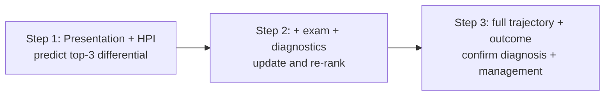

### 8.7 Audit findings and fixes

An audit script ran on every frozen file and materially changed the resource:

| # | Finding | Fix |
|---|---|---|
| 1 | Near-duplicate test items | 4 removed from earlier 613-item test set |
| 2 | First P4 had 45 of 201 checkable rows crossing a clinical band; 53 rows unchanged | Regenerated until 0 of 189 checkable rows crossed a band |
| 3 | First P5 changed only 1 of 273 questions | Rebuilt; reported as a narrow subset (21 items) |
| 4 | 7 of 118 D1 stage-1 texts contained all gold-diagnosis words | Scrub; 100 of 118 cases kept |
| 5 | First heading-aware index had chunks up to 9,105 words | Re-split to a 500-word cap |

Audit status: **0 FAILs, 0 WARNs**; 0 exact matches and 0 near-duplicates between test and train/val; 0 shared 13-grams between test sets and the D4 knowledge base. The 95% CI half-width is ±3.9 pp at n = 609 (baseline accuracy ≈ 0.60).

```bash
python audit_data.py --root "."
```

### 8.8 Integrity manifest (SHA-256)

| Artifact | N | SHA-256 |
|---|---:|---|
| `artifacts/D1_cases_staged.jsonl` | 100 | `d92e30b91a1f36a7724444612dae79676d8a481cfd4a6854027cfd06f32ee66c` |
| `artifacts/D2_test_clean.jsonl` | 609 | `e2fa56d15a5bf85e9e22e3de96ce554586a86165e2b8ae48823a67603e6437b1` |
| `artifacts/D2_val_clean.jsonl` | 613 | `c306b38e2f25ba7144d18fa1c7a055ab4a75f0ad96b611acab7a1f8ff06be4d1` |
| `artifacts/D2_train_clean.jsonl` | 4,910 | `e0f3ffe98b28a36d4c76c1fc581360da689d19fe645d4537ebbf89dd59abc154` |
| `artifacts/D3_P1_permutations.jsonl` | 609 | *See `data/manifests/D3_manifest.txt` and `data/README.md` for the full hash* |
| `artifacts/D3_P3_noise.jsonl` | 273 | `5418e169a15a068dda44def8a6540ea13c81248a6e7a8be3c8d376be56d3c648` |
| `artifacts/D3_P4_jitter.jsonl` | 200 | `aca27db002f8a3460986655e53953a776e318bbdecc6e0b5166657239af6dff7` |
| `artifacts/D3_P5_stripped.jsonl` | 21 | `ef4cba0fe48d0cd6ce420d57f3849a63bab6be8d19eeb45ef7c2ebc126daa20d` |
| `artifacts/D5_retrieval_benchmark.jsonl` | 46 | `f86dc24eb0b0e1911dba4b5d49b36900a4d5ea832a27a0e81f0f73fbe6cdb5b5` |
| `artifacts/D6_progressive_reveal.jsonl` | 100 | `4543a497ada11d65ca0444b2a37ab9d424ae709c97585fc84a8aacd4dede35b3` |
| `knowledge base/indexed chunks/D4_cardiology_kb.jsonl` | 959 | `8977352040efbee3926d6c4e0641f833c0903ba5abaaf280de080e228e1901b0` |
| `knowledge base/indexed chunks/D4_cardiology_kb_hierarchical.jsonl` | 1,055 | `949364fad322bc5aa436733d84f5e24f8c76149c6a78c32d3d9ca3257b413b3b` |

> The P1 hash is referenced to the manifest rather than reproduced here to avoid transcription errors; `audit_data.py` verifies every hash.

---

## 9. Experimental Design

### 9.1 Systems compared

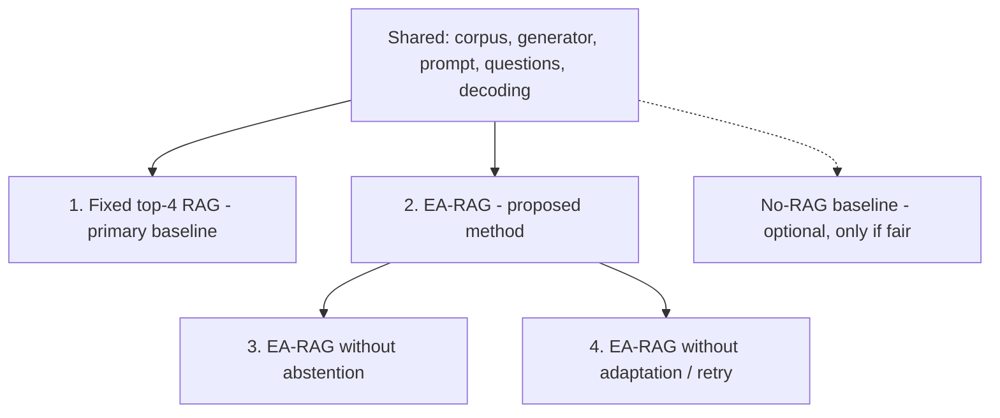

### 9.2 Generator and configuration

- **Generator:** `gemma4:31b` via Ollama Cloud's OpenAI-compatible endpoint, temperature 0, 45 s default request timeout.
- **Prompt:** question, options, and retrieved passages; must end with `FINAL ANSWER: X`. A strict parser extracts the option letter.
- **Errors:** the full D2 baseline and EA-RAG runs had **zero generator errors**.
- **Run manifests** record corpus and source-manifest hashes, model name, retrieval method, thresholds, and question count.
- **Limitations:** the cloud model's exact serving revision was not captured. Questions, options, and retrieved guideline passages are sent to a hosted endpoint, so no patient data may be used.

### 9.3 Threshold calibration

To avoid generation calls, **100 records** were sampled from D2 validation (seed 17) and the distribution of their top-1 lexical score was computed. Thresholds were set from percentiles of that distribution only, then frozen before the test run:

| Threshold | Value | Percentile |
|---|---|---|
| `τ_min` | 0.9256 | 10th |
| `τ_retry` | 0.9294 | 15th |

> This fixes **nominal rates, not a correctness trade-off**. It assumes the lowest-scoring 10–15% of questions are the ones the generator answers wrongly — an assumption never checked against correctness labels.

### 9.4 Two-pass execution and derived ablations

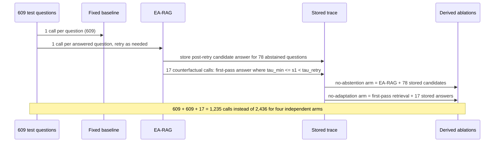

Derived arms are paired by question ID. The design assumes stored candidates equal what an independent run would produce; temperature 0 helps, but determinism of a cloud-served model is not guaranteed.

### 9.5 Metrics and statistics

- **Overall accuracy:** all 609 questions; an abstention counts as incorrect.
- **Coverage / abstention rate:** fraction answered / one minus coverage.
- **Selective accuracy:** accuracy among answered questions.
- **Retry rate**, **latency** (primary-path; counterfactual calls excluded).
- **Retrieval/pipeline metrics:** citation structure validity, Hit@k (when relevance labels exist), simple reference-answer substring rate (**not** a clinical correctness metric).
- **Statistics:** exact McNemar tests on item-level correctness; Wilson 95% intervals for proportions.
- **Not inferred by the prototype** (require human review): unsupported-answer rate and semantic citation support.

---

## 10. Detailed Results

### 10.1 Main comparison (D2 test, 609 questions)

See the table in [Section 2](#2-headline-results). Figure-style summary of coverage vs. selective accuracy:

| Arm | Coverage | Selective accuracy [Wilson 95%] |
|---|---|---|
| Fixed top-4 | 100.0% | 91.1% [88.6, 93.1] |
| EA-RAG | 87.2% | 91.7% [89.1, 93.8] |
| w/o abstention | 100.0% | 92.1% [89.7, 94.0] |
| w/o adaptation | 83.4% | 91.5% [88.8, 93.7] |

**Lower coverage did not raise accuracy among answered questions**; all intervals overlap.

### 10.2 Paired exact McNemar tests

"Discordant" lists questions correct only for the first arm / only for the second arm.

| Comparison (first vs. second) | Population | Discordant | Exact p |
|---|---|---|---|
| Fixed vs. EA-RAG | all 609 | 72 / 4 | 3.59 × 10⁻¹⁷ |
| EA-RAG vs. EA-RAG w/o abstention | all 609 | 0 / 74 | 1.06 × 10⁻²² |
| EA-RAG vs. EA-RAG w/o adaptation | all 609 | 22 / 0 | 4.77 × 10⁻⁷ |
| Fixed vs. EA-RAG | 531 answered by EA-RAG | 2 / 4 | 0.6875 |
| Fixed vs. EA-RAG w/o abstention | all 609 | 2 / 8 | 0.1094 |

### 10.3 What the abstentions removed

- EA-RAG abstained on **78** questions.
- With abstention disabled, the saved answers were correct for **74 (94.9%, Wilson 87.5–98.0%)** — abstention removed 74 correct answers and only 4 incorrect ones.
- The fixed baseline answered 70 of the same 78 correctly (89.7%).
- The no-abstention accuracy on those questions (94.9%) is numerically **higher** than EA-RAG's selective accuracy on answered questions (91.7%) — the opposite of what a useful gate would produce. (Not formally tested; only 78 abstentions.)

### 10.4 Retry, thresholds and cost

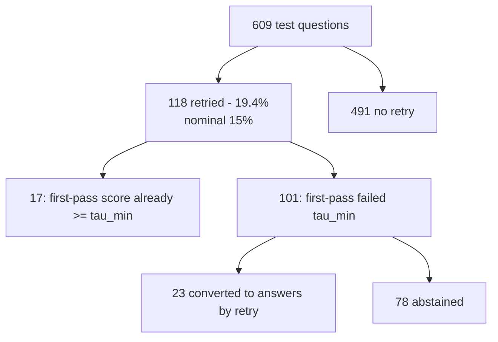

- The no-adaptation arm abstains on exactly the **101 first-pass failures** (16.6% of the test set) vs. a nominal 10%.
- Retry converted **23 of 101** into answers, raising coverage **83.4% → 87.2%**, with selective accuracy 91.5% vs. 91.7%.
- Only **17 questions (2.8%)** fell in the band between the two cutoffs, which are just 0.0038 apart — the score distribution is highly compressed.

**Latency (primary path):**

| Arm | Mean | Median |
|---|---|---|
| Fixed | 1.843 s | 1.830 s |
| EA-RAG | 1.621 s | 1.633 s |
| EA-RAG w/o abstention | 1.816 s | 1.748 s |
| EA-RAG w/o adaptation | 1.623 s | 1.633 s |

EA-RAG's lower latency is consistent with abstained questions skipping generation (not measured separately). The two full passes took ≈18.7 min (fixed) and ≈18.9 min (EA-RAG including retry and counterfactual work). Slowest complete record: 8.68 s (baseline) vs. 5.96 s (EA-RAG).

### 10.5 P5 stress test (21 anchor-stripped questions)

| Arm | Correct | Accuracy [95% CI] | Abstentions | Retries | Answer changed vs. unperturbed |
|---|---|---|---|---|---|
| Fixed | 19/21 | 90.5% [71.1, 97.4] | 0 | 0 | 2/21 |
| EA-RAG | 19/21 | 90.5% [71.1, 97.4] | 0 | 0 | 1/21 |

No P5 question fell below either threshold. With 21 items concentrated on a single anchor phrase, this shows the gate **did not respond to the removal**; it neither demonstrates robustness nor detects the removed anchors.

### 10.6 D1 stage-1 retrieval-only audit

| Measure | Result |
|---|---|
| Stage-1 cases | 100 |
| Initial retrievals below retry cutoff | 23 (23%) |
| Final abstentions after at most one retry | 10 (10%) |
| Post-retry coverage | 90% |
| Median initial top-1 score | 0.9464 (validation median: 0.9566) |
| Diagnostic accuracy | **Not measured** |

No diagnostic accuracy is reported: there is no validated diagnosis matcher and stage texts overlap heavily with abstracts. Combined with the keyword audit, this *suggests* the gate passes most cases on lexical overlap rather than topical coverage — suggestive, not conclusive.

---

## 11. Discussion

### 11.1 The gate did not track correctness

Giving up 12.8% of coverage bought no measurable gain in selective accuracy, removed 74 correct answers against 4 incorrect ones, and lowered overall accuracy by 11.1 points. Plausible (untested) explanations:

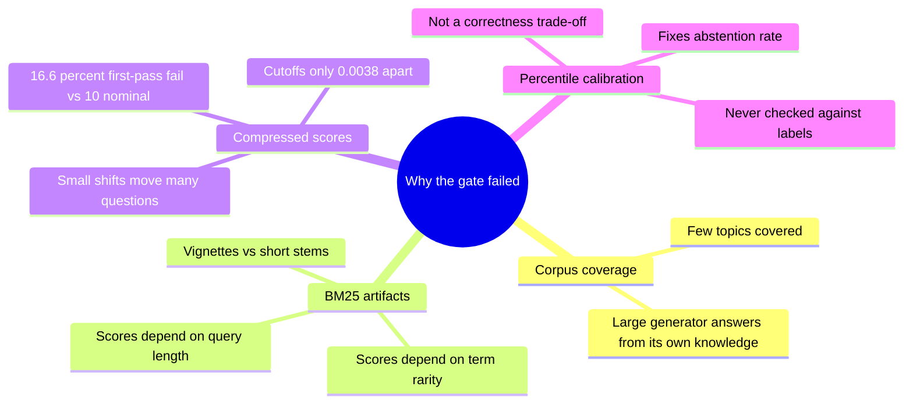

A gate should instead be calibrated against **correctness labels on held-out data** and assessed with a full **risk–coverage analysis** before being described as a safety mechanism.

### 11.2 What worked

The retry was the one component with a measurable benefit: it converted 23 first-pass abstentions into answers, and the always-answering retry variant had the highest numerical overall accuracy (92.1%). The effect over the fixed baseline is **not significant** (p = 0.1094), so it is a lead, not a finding. The two-pass design also roughly halved model calls.

### 11.3 Relation to hallucination claims

Systems motivated by hallucination reduction should report selective-prediction behavior, not only accuracy. For benchmark questions that models partly know, retrieval evidence and answer reliability can come apart; for rarer topics the corpus does not cover, the relation may differ. This experiment cannot say which regime matters clinically.

---

## 12. Threats to Validity

1. D2 consists of academic examination questions, not clinician-authored cases; MedQA/MedMCQA may have been seen by the generator during training.
2. One generator, one retrieval method (lexical), and one run per configuration; dense retrieval was not evaluated; ablations are derived from stored traces (assumes deterministic regeneration).
3. The cloud model's serving revision was not captured.
4. No human review of whether cited passages support answers; citation checks are structural only.
5. D5 relevance labels are heuristic and don't match heading-aware chunk identifiers.
6. P5 is small and narrow; P1, P3, and P4 were built and audited but not evaluated.
7. D1 has no validated diagnosis matcher and substantial abstract overlap.
8. The guideline corpus is small, and source and model terms of use must be checked before redistribution or external processing.
9. Results are exploratory; no clinical safety or usefulness claim is made.

Additional caveats: retrieval scores are ranking signals, not calibrated confidence; there is no automatic contradiction detector and no clinician-validated benchmark.

---

## 13. Current Implementation

- Source manifest validation and ingestion from local UTF-8 `.txt`/`.md` files.
- Stable heading-aware chunks with source metadata and JSONL persistence.
- Deterministic BM25-style lexical retrieval; optional CPU sentence-transformer cosine retrieval with a content/model-keyed embedding cache.
- Fixed top-k baseline and EA-RAG with keyword intent routing, query expansion, configurable evidence threshold, one retry, and abstention.
- Deterministic extractive generator (labeled fallback), structural citation validation, JSONL evaluation records, aggregate JSON metrics, and run manifests.
- Optional OpenAI-compatible Chat Completions generation with a grounded prompt; API/network errors are returned as explicit failed runs.
- Ablations without abstention and without adaptation/retry.
- Minimal Streamlit interface.
- Strict `FINAL ANSWER: A` MCQ parser reporting accuracy and coverage.

The reported evaluation used **hierarchical D4 and D2 MCQs, lexical retrieval, and Ollama Cloud `gemma4:31b`**; it did **not** use embeddings or a vector database.

---

## 14. Setup and Usage

### 14.1 Setup (PowerShell)

```powershell
.\.venv\Scripts\python.exe -m pip install -r requirements.txt
$env:PYTHONPATH = "src"
```

Ingestion, chunking, and lexical retrieval use only the Python standard library. Dense retrieval uses `sentence-transformers` on CPU and caches vectors under `artifacts/indices` (the first run downloads the model). `streamlit` runs the demo and `pytest` runs unit tests.

### 14.2 Configure generation

Default is the labeled extractive fallback. For Ollama Cloud, copy `.env.example` to `.env` and set:

```text
OLLAMA_API_KEY=...
OLLAMA_MODEL=...
OLLAMA_BASE_URL=https://ollama.com/v1
```

`OPENAI_API_KEY`, `OPENAI_MODEL`, and `OPENAI_BASE_URL` are also accepted. Process environment variables take precedence over `.env`. Restart the app after changes.

> The request sends the question and retrieved public passages to the configured endpoint. **Never use personal health information.** The API key is read from `.env`/environment and is **never written to run artifacts**.

### 14.3 Add sources and build the corpus

Create one local `.txt`/`.md` file per public source. The manifest is a JSON array (paths relative to the manifest file):

```json
[
  {
    "document_id": "organization-topic-2026",
    "title": "Exact title of the source",
    "publisher": "Publishing organization",
    "url": "https://publisher.example/source",
    "published_date": "YYYY-MM-DD",
    "accessed_date": "YYYY-MM-DD",
    "license_note": "License or terms permitting this use",
    "path": "organization-topic.md"
  }
]
```

```powershell
python -m cardio_rag.cli ingest
```

Chunk defaults: 550 words, 80-word overlap. `data/processed/chunks.jsonl` is Git-ignored; preserve your sources and manifest to reproduce it. The tool does not fetch URLs or verify licenses.

### 14.4 Ask and evaluate

```powershell
python -m cardio_rag.cli ask "What is the definition of atrial fibrillation?" --variant ea_rag
python -m cardio_rag.cli evaluate --questions data/evaluation/dev.jsonl --run-id pilot
python -m cardio_rag.cli evaluate --questions data/evaluation/dev.jsonl --run-id pilot-dense --retrieval dense
```

Question JSONL requires a non-empty `question`; optional fields: `question_id`, `reference_answer`, `relevant_chunk_ids`. The evaluator runs baseline, EA-RAG, no-abstention, and no-adaptation variants on the same records and writes `artifacts/pilot.jsonl`, `artifacts/pilot_metrics.json`, and `artifacts/pilot_manifest.json`.

### 14.5 Run the D2 MCQ split on pre-chunked D4

Pass the D4 source metadata file so the loader preserves each existing `chunk_id` and attaches provenance. For a local Ollama server, set `OLLAMA_MODEL=llama3.1:8b` and `OLLAMA_BASE_URL=http://localhost:11434/v1` (no API key needed for localhost). The extractive fallback cannot answer MCQs, so the evaluator **stops rather than reporting fake accuracy** if no language model is configured.

```powershell
$env:UV_CACHE_DIR = Join-Path (Get-Location) '.uv-cache'
$env:PYTHONPATH = 'src'
$env:OLLAMA_MODEL = 'llama3.1:8b'
$env:OLLAMA_BASE_URL = 'http://localhost:11434/v1'
uv run --python .venv\Scripts\python.exe python -m cardio_rag.cli evaluate `
  --questions data\artifacts\D2_val_clean.jsonl `
  --corpus 'data\knowledge base\indexed chunks\D4_cardiology_kb_hierarchical.jsonl' `
  --source-manifest data\manifests\D4_sources.json `
  --retrieval dense --sample-size 50 --include-options-in-query `
  --output data\artifacts\runs --run-id d2-val-50
```

Notes:
- The evaluator disables the personal-symptom chat guard **only for evaluation**.
- The **frozen D2 run used stem-only retrieval** and thresholds from D2 validation score quantiles.
- Lexical retrieval is the default and needs no model download. Dense retrieval defaults to `sentence-transformers/all-MiniLM-L6-v2`; override with `CARDIO_RAG_EMBEDDING_MODEL` / `--embedding-model`, and pin a revision with `CARDIO_RAG_EMBEDDING_REVISION` / `--embedding-revision`.
- The initial dense threshold is a heuristic and must be tuned on development data only.
- D5 labels match only fixed-window D4 IDs and are keyword-generated candidates.

### 14.6 Run the interface

```powershell
python -m streamlit run src/cardio_rag/app.py
```

### 14.7 Verify the data

```bash
python audit_data.py --root "."
```

---

## 15. Optional Datasets: NHLBI and MedQA-USMLE

### 15.1 Supplied NHLBI data

The optional `prepared_data/` folder contains NHLBI QA candidates, downloaded page text, and pre-split passages.

```powershell
$env:UV_CACHE_DIR = Join-Path (Get-Location) '.uv-cache'
uv run --python .venv\Scripts\python.exe python scripts\prepare_nhlbi_evaluation.py
```

Outputs go to `prepared_data/processed/`: `chunks.jsonl`, `all_candidates.jsonl`, `train.jsonl`, `dev.jsonl`, `test.jsonl`, `review_template.csv`, and a preprocessing report. All questions from one source document stay in the same split. Relevance suggestions live in `candidate_retrieved_chunk_ids`; `relevant_chunk_ids` is intentionally **empty until reviewed**. These are **not** benchmark results until relevance, source captures, reference answers, source terms, answerability, and supporting chunks are reviewed (see `prepared_data/dataset desc.md`).

### 15.2 Local MedQA-USMLE copy

An external copy may be placed under `data/MedQA-USMLE/` (that directory and `data/archive.zip` are Git-ignored). Its US `dev.jsonl`/`test.jsonl` are a possible secondary set of USMLE-style MCQs — **not** a consumer cardiology FAQ benchmark.

```powershell
python scripts/prepare_medqa_candidates.py
python scripts/prepare_medqa_candidates.py --split dev
```

The script reads one official split at a time and writes a **review-only** candidate JSONL under `data/processed/`. Keyword matches are overinclusive and must be manually checked; the output is not a vetted benchmark, and the normal evaluator does not consume it automatically. To ingest the supplied English textbook extracts locally:

```powershell
python scripts/prepare_medqa_manifest.py
python -m cardio_rag.cli ingest --manifest data/processed/medqa_sources_manifest.json --output data/processed/medqa_chunks.jsonl
```

The MedQA paper describes its textbook collection as released under a **research-use-only** license. Use only under the terms applicable to your copy; **do not redistribute source text or derived passages**; preserve provenance and cite the dataset paper.

---

## 16. Safety, Privacy and Licensing

- **Not a medical device.** Educational research prototype only; never use outputs for clinical decisions.
- **Public educational corpus only;** no personal patient data. The UI warns users not to enter personal health information.
- **Safety notice:** the pipeline returns a short notice directing users to local emergency services/qualified care for recognized first-person symptom queries. It uses simple keyword matching and is **not a triage system**; it does not try to determine whether someone is having an emergency.
- **Logging:** log no unnecessary personal data; avoid sending sensitive text to third-party APIs; never log API keys.
- **Framing:** all outputs are experimental research results, not clinical performance guarantees.
- **Licensing:** check source and dataset licenses before external processing or redistribution. Guideline and question-dataset text is **not redistributed**; users must check original source terms and the model provider's terms before reuse. D1 case reports are CC-BY; MedQA textbook extracts are research-use-only.
- **Model serving:** questions, options, and retrieved guideline passages are sent to the hosted endpoint when using Ollama Cloud.

---

## 17. Repository Layout

```text
.
├── README.md                              # This document
├── docs/
│   ├── REPORT.md                          # Full experiment report (methods, artifacts, results, limits)
│   ├── ARCHITECTURE.md                    # System architecture and design contracts
│   └── TODO.md                            # Remaining research and implementation work
├── src/cardio_rag/                        # Pipeline, CLI, retrieval, generation, Streamlit app
├── scripts/                               # prepare_nhlbi_evaluation.py, prepare_medqa_*.py, ...
├── prepared_data/                         # Optional NHLBI QA candidates (+ processed/ outputs)
├── requirements.txt
├── .env.example
└── data/
    ├── README.md                          # Dataset specification and audit documentation
    ├── audit_data.py                      # Automated sanity check and verification script
    ├── audit_report.txt                   # Output log of the data audit
    ├── artifacts/                         # Frozen splits
    │   ├── D1_cases_staged.jsonl          # 100 staged cases
    │   ├── D2_{test,val,train}_clean.jsonl# 609 / 613 / 4,910 MCQs
    │   ├── D3_P1_permutations.jsonl       # 609
    │   ├── D3_P3_noise.jsonl              # 273
    │   ├── D3_P4_jitter.jsonl             # 200
    │   ├── D3_P5_stripped.jsonl           # 21
    │   ├── D5_retrieval_benchmark.jsonl   # 46 heuristic candidate pairs
    │   └── D6_progressive_reveal.jsonl    # 100 staged prompts
    ├── knowledge base/
    │   ├── raw guidelines/                # ehad191.pdf, ehag100.pdf, otto-et-al-2020...pdf
    │   └── indexed chunks/
    │       ├── D4_cardiology_kb.jsonl                 # 959 fixed-window chunks
    │       └── D4_cardiology_kb_hierarchical.jsonl    # 1,055 heading-aware chunks
    ├── manifests/                         # SHA-256 manifests D1-D6 (+ D4_sources.json)
    └── scripts/                           # build_d2.py, fetch_d1_raw.py, fix_d1_cases.py,
                                           # fix_p4_jitter.py, fix_p5_stripped.py,
                                           # build_d4_chunks.py, build_d4_heading_aware.py,
                                           # build_d5_retrieval.py, purge_near_dups.py
```

> Directory names above follow the source READMEs; adjust paths if your checkout differs.

---

## 18. Roadmap / Remaining Work

### Highest priority

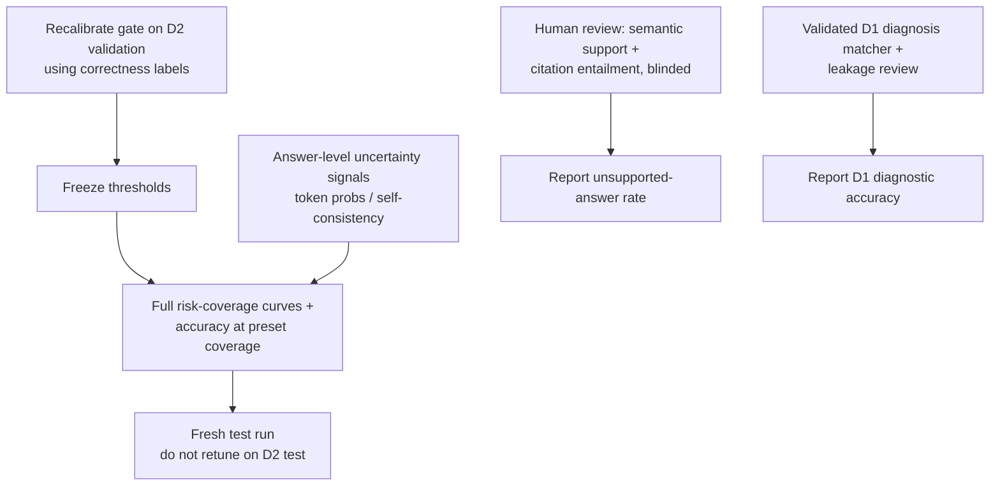

- **Tune the evidence gate** on D2 validation using answer correctness and a risk–coverage analysis, not score percentiles alone. The current threshold is frozen and reported; **do not retune against D2 test and present the same test as untouched.**
- **Manually annotate** a relevance subset for the hierarchical D4 corpus (D5 IDs target the fixed corpus and aren't gold).
- **Blinded human review** of semantic support and citation entailment.
- **Build and validate a D1 diagnosis matcher** and review title/abstract leakage before reporting D1 diagnostic accuracy.
- **Broader perturbation evaluation:** run P1, P3, P4 and perturbations of D1; the 21-item P5 set triggered no retries or abstentions.

### Retrieval and reproducibility
- If source terms permit, build a **dense-index comparison** with a pinned embedding revision (headline results are lexical only).
- Record immutable model-serving revision, token/cost data, and decoding/provider details.
- Review the **4 flagged OCR-damage markers** in each of D2 validation and test (MedMCQA records).
- Confirm external API processing and redistribution terms for D4-derived guideline chunks before repeating or publishing generated content.
- Evaluate broader corpora and alternative generators under the same frozen benchmark.

### Dataset scope
- D6 is linked to D1 (100/100 DOI links) and must **not** be counted as an independent cohort.
- Keep MedQA-USMLE/textbook-derived assets within their license terms; keyword candidate lists need human review before use as benchmarks.
- Add sources only with verified provenance and terms permitting the planned use.

---

## 19. Definition of Done

- [x] Reproducible ingestion and index build.
- [x] Baseline RAG and EA-RAG both runnable.
- [x] Evaluation script produces machine-readable outputs and metrics.
- [x] At least one ablation and documented error analysis.
- [x] UI shows sources and abstention state.
- [x] Documentation states limitations and reports only measured results.

---

## 20. References

1. Z. Yang, C. Chen, S. S. Mahmoud, X. Tan, Y. Chen, and Q. Fang, "Cardiology-Chat: A multi-LLMs powered system for cardiac diagnostic reasoning and clinical support," *IEEE J. Transl. Eng. Health Med.*, vol. 14, pp. 123–132, 2026. DOI: [10.1109/JTEHM.2026.3668755](https://doi.org/10.1109/JTEHM.2026.3668755).
2. P. Lewis et al., "Retrieval-augmented generation for knowledge-intensive NLP tasks," *NeurIPS*, vol. 33, 2020.
3. G. Xiong, Q. Jin, Z. Lu, A. Zhang, "Benchmarking retrieval-augmented generation for medicine," arXiv:2402.13178, 2024.
4. K. Singhal et al., "Large language models encode clinical knowledge," *Nature*, vol. 620, 2023.
5. A. Asai et al., "Self-RAG: Learning to retrieve, generate, and critique through self-reflection," *ICLR* 2024, arXiv:2310.11511.
6. S.-Q. Yan et al., "Corrective retrieval augmented generation," arXiv:2401.15884, 2024.
7. S. Jeong et al., "Adaptive-RAG: Learning to adapt retrieval-augmented large language models through question complexity," *NAACL* 2024, arXiv:2403.14403.
8. R. El-Yaniv and Y. Wiener, "On the foundations of noise-free selective classification," *JMLR*, vol. 11, 2010.
9. Y. Geifman and R. El-Yaniv, "Selective classification for deep neural networks," *NeurIPS*, vol. 30, 2017.
10. C. Guo et al., "On calibration of modern neural networks," *ICML*, 2017.
11. S. Kadavath et al., "Language models (mostly) know what they know," arXiv:2207.05221, 2022.
12. D. Jin et al., "What disease does this patient have? A large-scale open domain question answering dataset from medical exams," *Appl. Sci.*, vol. 11, no. 14, 2021 (MedQA).
13. A. Pal, L. K. Umapathi, and M. Sankarasubbu, "MedMCQA: A large-scale multi-subject multi-choice dataset for medical domain question answering," *CHIL*, 2022.
14. S. Robertson and H. Zaragoza, "The probabilistic relevance framework: BM25 and beyond," *Found. Trends Inf. Retr.*, vol. 3, no. 4, 2009.
15. E. B. Wilson, "Probable inference, the law of succession, and statistical inference," *JASA*, vol. 22, no. 158, 1927.

---